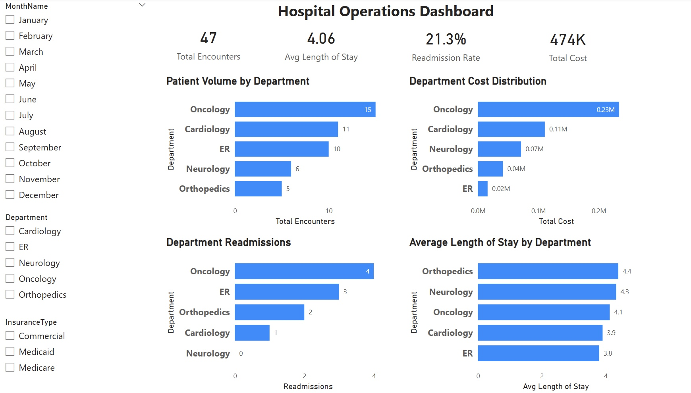

# Hospital Operations Dashboard (Power BI)

## Overview

This project presents an interactive Power BI dashboard analyzing hospital operational performance across departments. The dashboard highlights key healthcare metrics including patient volume, readmission rates, length of stay, and departmental cost distribution.

The Power BI file is CareFlow_Insights_PowerBI.pbix, and the source data is in careflow_insights_data.xlsx. The screenshot below shows the final dashboard.The screenshot below shows the final dashboard, and the source data is in careflow_insights_data.xlsx

## Dashboard Preview

## Key Features

* KPI cards tracking total encounters, average length of stay, readmission rate, and total cost
* Department-level analysis of patient volume, readmissions, and operational efficiency
* Cost distribution visualization across hospital departments
* Interactive filters for month, department, and insurance type

## Tools Used

* Power BI
* DAX
* Data Modeling
* Data Visualization

## Key Findings

Based on 47 simulated hospital encounters across 5 departments in 2025.

- **Delayed discharges drive length of stay.** 45% of encounters had a delayed discharge. Those stays averaged 5.7 days, compared with 2.7 days for on-time discharges.
- **The ER is the biggest throughput problem.** ER stays averaged 3.8 days against a 2-day target, and 80% of ER encounters had a delayed discharge.
- **Oncology concentrates cost.** Oncology accounted for 32% of encounters but 49% of total cost ($234K of $474K), averaging $15.6K per encounter.
- **Readmissions cluster in Orthopedics and the ER.** The overall readmission rate was 21%, with Orthopedics at 40% and the ER at 30%. Neurology had no readmissions.
- **Chronic conditions raise readmission risk.** Patients with a chronic condition were readmitted 26% of the time, compared with 8% for patients without one. Medicare patients (29%) were readmitted more often than Commercial patients (19%).
